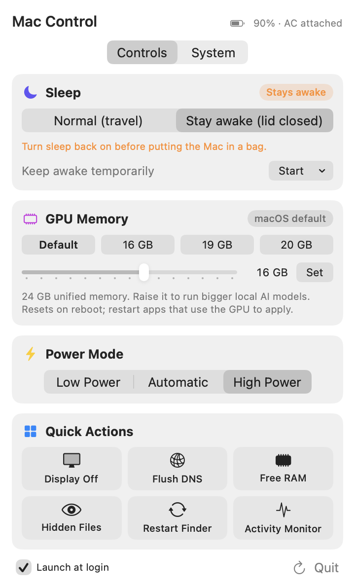
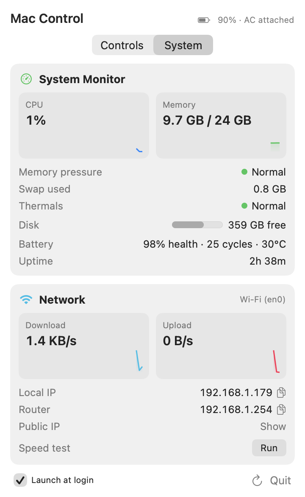

# Mac Control

A native macOS menu bar app for the power-user settings macOS hides: lid-closed sleep, the Apple Silicon
GPU memory limit, power mode, and a live system and network monitor.

**Swift · SwiftUI · AppKit · Mach/BSD system APIs · macOS 14+ (Apple Silicon)**

  
  &nbsp;&nbsp;
  

> The source code is in a private repository. I'm happy to walk through it or share access for interviews.
> Contact me through my GitHub profile.

## Why I built it

I ran these settings from a folder of Terminal scripts: keep the Mac awake with the lid closed for overnight
jobs, raise the GPU memory limit to run larger local AI models, and turn both back off before travelling.
The scripts worked, but it was easy to forget which state the Mac was in. Mac Control puts every setting one
click away in the menu bar and always shows the current state.

## Features

**Controls**
- **Sleep:** stay awake with the lid closed, or keep awake for a set time. A warning appears while sleep is
  off, so the Mac doesn't overheat in a bag.
- **GPU memory:** raise or reset the Apple Silicon GPU wired-memory limit. Presets and the slider scale to the
  Mac's installed RAM.
- **Power mode:** Low Power / Automatic / High Power, with a fallback for Macs without High Power mode.
- **Quick actions:** display off, flush DNS, free RAM, toggle hidden files, restart Finder, open Activity Monitor.
- **Launch at login.**

**System monitor**
- CPU and memory with live sparklines, memory pressure, swap, thermal state, free disk space.
- Battery health, cycle count and temperature.
- Network: live download/upload rates, active interface, local and router IP, public IP (on request) and a
  built-in speed test.

## Technical highlights

- **Native system APIs instead of shelling out:** CPU and memory come from Mach host statistics, swap and
  memory pressure from `sysctl`, network throughput from interface byte counters, and interface names from
  `SystemConfiguration`. Sampling runs only while the monitor is visible, so the app does no work in the background.
- **Safe privilege handling:** admin changes use the standard macOS password prompt. There's no privileged
  helper and no stored password.
- **Source of truth is the system:** state is re-read from macOS every time the panel opens, so the UI never
  disagrees with the Mac, even when a setting was changed from Terminal.
- **No Xcode project and no dependencies:** a single build script compiles with `swiftc`, draws the app icon
  in code, assembles the `.app` bundle and code-signs it.
- **Built-in screenshot mode:** a `--snapshot` launch flag renders the UI to PNG, which is how these
  screenshots were made.

## Status

In daily use on my own MacBook. ~1,100 lines of Swift across two source files.

---

© 2026 vaniilla9. All rights reserved.
